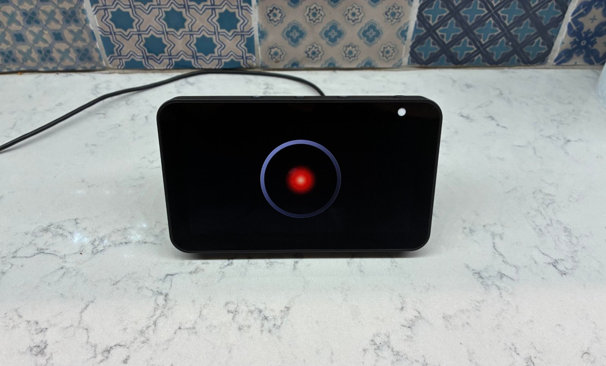

# hal-echo-show


-lightgrey?style=flat-square)


> *"I am putting myself to the fullest possible use."*

Turn a jailbroken Echo Show 5 into a room speaker for [hal-voice](https://github.com/NotEoin/hal-voice):
HAL's red eye on the screen from the moment it boots, listening for its name, answering in HAL's
voice. The Echo does the listening; your PC does the transcription, the thinking and the voice,
over an encrypted link that only your paired devices can open.



```
 Echo Show (LineageOS)                                    your PC
 mic -> loudness gate -> "Hal" spotter (Vosk)              hal-echo bridge
                -> request recording            ==>   faster-whisper -> brain (as hal-voice)
 speaker <- eye <------------------------------- <==   HAL voice (GPT-SoVITS + FX + speaker EQ)
              TLS 1.3, both certificates pinned at pairing (6-digit code, CPace)
```

- **Pair once with a code.** The Echo shows six digits, you type them on the PC, and both sides pin
  each other's certificate. It needs no cable, account or cloud service.
- **Encrypted and authenticated.** Every byte between the Echo and the PC is TLS 1.3. Nobody else on
  your network can listen in, or pose as either end.
- **Only what you say to Hal leaves the device.** The Echo spots "Hal" itself and drops every
  other sentence unheard; only a request addressed to Hal is sent, over the encrypted link.
- **Quiet room, idle device.** With nobody talking, the Echo only measures loudness. Any sound
  wakes the wake-word spotter for five minutes, so "Hey Hal" is caught as soon as someone comes in.
- **Several rooms, one answer.** Put Echos around the house; when two hear the same "Hey Hal", the
  nearer one answers.
- **Three modes.** `desk` replaces hal-voice at your desk, `personal` is a private room without the
  desktop tools, and `home` is a shared room (Home Assistant, a stub for now).
- **A hardware monitor on demand.** "Hey Hal, open the hardware monitor" shows btop, running on
  your PC, in a terminal on the Echo; "close the monitor" brings the eye back.

## Part of the Hal suite

hal-echo-show extends [hal-voice](https://github.com/NotEoin/hal-voice), which is one part of
[Hal](https://github.com/NotEoin/Hal), a modular AI assistant that runs on your own machine, built
privacy and security first. It uses hal-voice's brains, voice and settings unchanged. Its pack
manifest (`halecho/hal-module.toml`) adds two tools to Hal, `echo_say` and `echo_devices`, so Hal
can speak through your Echos (`hal packs add --local PATH`; not yet run through hal-hub).

## Requirements

| | |
|---|---|
| Echo | An **Echo Show 5, 1st generation (2019, codename checkers)**, unlocked and running LineageOS 18.1. See the warning below. |
| PC | Linux with a working [hal-voice](https://github.com/NotEoin/hal-voice) checkout (its brain and GPT-SoVITS voice). |
| Python | 3.11 or 3.12, as hal-voice. |
| System packages | libsodium 1.0.18 or later (`libsodium23` on Debian and Ubuntu), and Docker to build the Android app. |
| Network | The Echo and the PC on the same LAN. Reserve both addresses in your router's DHCP settings. |

## Unlock the Echo first

**This can permanently brick your Echo.** The unlock exploits the boot chain, works only on the
1st-generation Echo Show 5 (2019, `checkers`), and Amazon patched it in Fire OS 6.5.7.1
(NS65751/8848, checked 2026-11-11): do not let an Echo you plan to unlock update. An interrupted
unlock, or flashing the wrong partition afterwards, can leave the device unrecoverable.

Follow the guide by its authors, not a summary of it:

- Unlock, root, TWRP and recovery:
  [XDA: Amazon Echo Show 5 1st Gen (checkers)](https://xdaforums.com/t/unlock-root-twrp-unbrick-amazon-echo-show-5-1st-gen-2019-checkers.4762900/)
- The ROM: [XDA: LineageOS 18.1 for the Echo Show 5 (2019)](https://xdaforums.com/t/rom-unofficial-11-checkers-lineageos-18-1-for-the-amazon-echo-show-5-2019.4763475/).
  Use build 5 (2026-04-18) or later, for its Wi-Fi fixes.

Nothing in this repository flashes, roots or repartitions the Echo. It installs one ordinary app.

## Install

On the PC, with hal-voice already working:

```bash
git clone https://github.com/NotEoin/hal-echo-show.git && cd hal-echo-show
./setup-pc.sh --unit       # a virtualenv with hal-voice and the bridge, and the systemd unit
.venv/bin/hal-echo doctor  # check libsodium, hal-voice, ports and models
android/build.sh apk       # build and sign the app in Docker (first run: about 10 minutes)
```

The [release page](https://github.com/NotEoin/hal-echo-show/releases) also has a built APK, but
`hal-echo push-update` can update only an app signed with your own key, so build your own if you
plan to update it. Then put the app on the Echo, pair it and turn off USB debugging:
[Set up the Echo](docs/howto/set-up-the-echo.md). It takes about fifteen minutes and every step can
be undone.

## Run

The bridge runs as a systemd user service:

```bash
systemctl --user enable --now hal-echo.service   # start the bridge now and at login
hal-echo pair --mode personal                    # pair another Echo
hal-echo devices                                 # paired devices, their modes, and which are online
hal-echo mode Kitchen home                       # change a device's mode
hal-echo say "Dinner is ready." --device Kitchen # speak on one Echo (or all, without --device)
hal-echo unpair Kitchen                          # its certificate stops working at once
```

On the Echo, hold the eye for two seconds for the menu: pair, rename, status, or Android's settings.
Say "Hey Hal, open the hardware monitor" for btop from the PC, full screen (desk and personal
mode); hold the screen for two seconds, or say "close the monitor", to go back. Like the eye, the
monitor drifts a few pixels each minute; it dims after two minutes without a touch or a word to
Hal, and closes after an hour.

## Configuration

The bridge's settings live in `~/.config/hal-echo-show/config.yaml`, and the brain and voice stay in
hal-voice's own settings. See [Configuration](docs/user/configuration.md) and [Modes](docs/user/modes.md).

## Security

Pairing uses CPace, a password-authenticated key exchange, so the six-digit code cannot be tested
offline by someone recording the exchange; each wrong attempt costs them one guess, and pairing
stops after three. After pairing, the link is TLS 1.3 and each end accepts only the certificate it
pinned. [SECURITY.md](SECURITY.md) has the threat model, including what this does not protect
against (the ROM runs SELinux permissive).

## Limitations

- **Speech recognition runs on the PC by default.** Whisper on the Echo itself works
  (`listener.stt_location: device`) but is slow: the ROM runs a 32-bit kernel on four 1.3 GHz
  cores, and `base.en-q5_1` took about 9 s per 4-second request once loaded (measured
  2026-11-11; `tiny.en` stalled in decoding). See the
  [benchmark](docs/howto/benchmark-whisper-on-the-echo.md).
- **No echo canceller, so no voice barge-in.** This ROM offers none, so the Echo hears HAL's voice,
  and HAL saying words close to "Hal" stopped his own replies. With `listener.barge_in: auto` the
  Echo ignores its microphones while HAL speaks; tap the eye to stop him.
- **Personal mode is enforced at the approval step.** It refuses desktop tools that ask for
  approval. A desktop tool that Hal's policy allows without asking still runs, until Hal can deny a
  pack per channel ([Modes](docs/user/modes.md)).
- **Home mode is a stub.** It answers that Home Assistant is not connected, and reaches none of
  your tools.
- **HAL's voice comes from the PC.** The Echo cannot run GPT-SoVITS, so with the PC off the Echo
  shows "Waiting for the PC" and stays silent.

## Test

```bash
uv run --frozen --extra test pytest -q    # bridge, pairing and protocol tests; no Echo, network or GPU
ruff check . && ruff format --check .
android/build.sh test                     # app unit tests (CPace vectors, listener) and lint
```

## Documentation

The [docs index](docs/README.md) lists every page.

## Licence

MIT, see [LICENSE](LICENSE). The app bundles libraries and a font under their own licences, and
the bridge downloads speech models under theirs: see [THIRD-PARTY.md](THIRD-PARTY.md).
